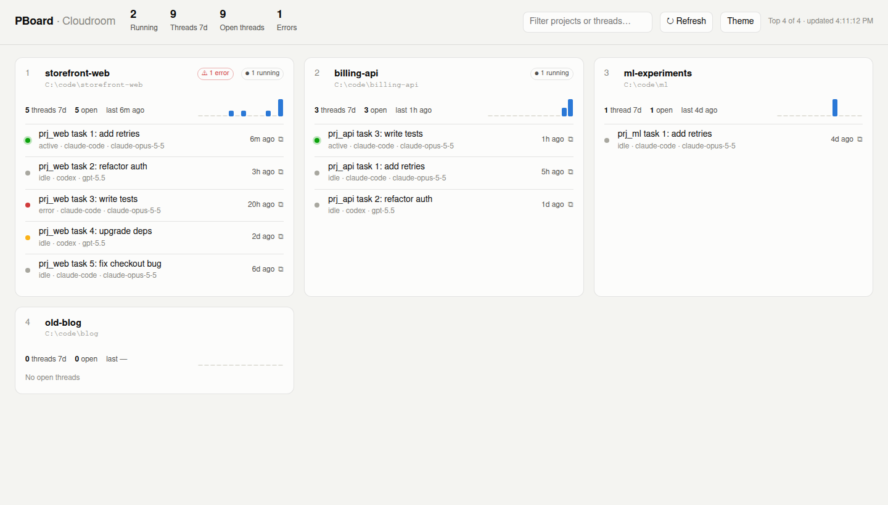

# PBoard

Personal board for your most active Cloudroom projects: running threads, errors, queued work, last-14-day activity, and the latest open threads per project.

## Run (on the computer where the Cloudroom app runs)

Needs Node 18+ and `room-cli` on PATH (ships with Cloudroom).

- Windows: double-click `start.cmd`
- Any OS: `node server.js`, then open http://127.0.0.1:4777

No dependencies, no build. Auto-refreshes every 60s; press `R` to refresh now.

## Settings (env vars)

| Var | Default | |
|---|---|---|
| `PBOARD_PORT` | `4777` | |
| `PBOARD_HOST` | `127.0.0.1` | keep it local: the board shows all your thread titles |
| `PBOARD_TOP` | `12` | how many projects to show |
| `PBOARD_CLI` | `room-cli` | path to the CLI |

## Ranking

score = 10 × running threads + 3 × threads active in last 7 days + recency (0–14, by days since last activity).

## Troubleshooting

If cards show odd titles or no times, your Cloudroom version uses different JSON field names. Open `/api/raw` (projects) or `/api/raw?project=ID` (threads) and adjust `normThread` in `server.js`.

## Why not in the cloud?

Project and thread data lives in the Cloudroom desktop app. Cloud sandboxes can't reach it on Windows yet, so the board runs locally.
