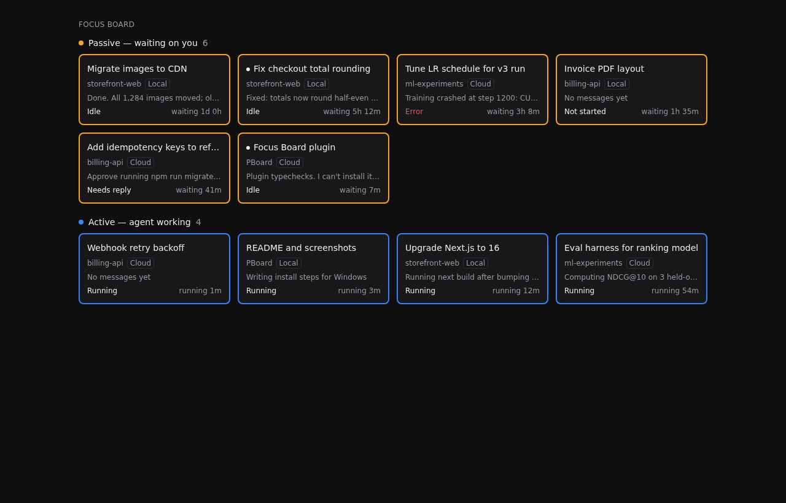

# Focus Board (Cloudroom plugin)

Every open thread across all your projects, as tiles, on the compose homepage and in a **Focus** nav panel.

- **Passive — waiting on you** (amber `#f5a524`): idle, finished, errored, not started, or blocked on an approval/question. Longest-waiting first.
- **Active — agent working** (blue `#3b82f6`): starting, running, stopping, or provisioning. Longest-running first.

Each tile: title, project, Local/Cloud, last agent message (one line), status, and waiting/running time. Click opens the thread. The nav badge counts threads waiting on you. Updates live from the host's realtime thread feed. All colors except the two borders are theme tokens.



## Install (on the computer running Cloudroom)

```sh
cd focus-board
npm install
room-cli plugin install .     # registers this folder in place
room-cli plugin dev           # rebuilds + reloads on every save
```

## Known approximations

- **Waiting/running time:** the SDK exposes no "status changed at" field. On first sight it uses `latestAttentionAt` (passive) or `updatedAt` (active); after that it records the real transition time for the app session.
- **Local/Cloud:** inferred from the thread's host (`machineProviderId`, ephemeral type, or "cloud" in the name). Check the label on a known Cloud thread after install.
- **Last message:** `sdk.threads.output()` (the agent's last output), refetched when the thread updates.
- Uses `experimental_useSidebarThreads`, an experimental SDK API that can change between Cloudroom releases.
